# Top 25 Digital Game Key Marketplaces Curated Selection in 2025 (Comprehensive Review)

Finding reliable platforms to purchase digital game keys at competitive prices remains a priority for PC, console, and mobile gamers worldwide. This curated selection evaluates 25 verified marketplaces offering instant delivery, buyer protection, and cost-effective access to Steam keys, Xbox Game Pass codes, PlayStation Network cards, and Nintendo eShop credits across diverse gaming libraries.

## **[Eneba](https://www.eneba.com)**

Fast-growing digital marketplace combining competitive pricing with comprehensive buyer protection and instant key delivery for PC and console gamers seeking discounts up to 70% off retail.

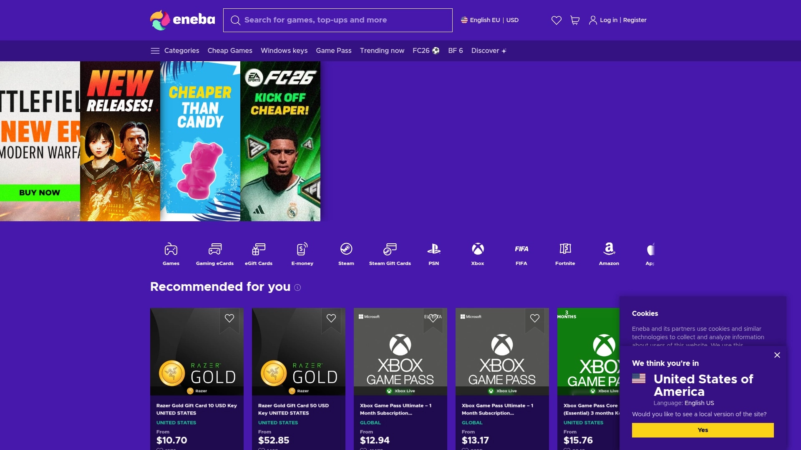

**Official Website:** [eneba.com](https://www.eneba.com)

- Delivers game keys, gift cards, and DLC codes instantly via email or web portal with 24/7 customer support and money-back guarantees on non-working keys
- Supports Steam, Xbox, PlayStation, Nintendo, Epic Games, and Uplay platforms with transparent seller ratings and region lock warnings displayed upfront
- Mobile app for iOS and Android enables purchases during gaming sessions with streamlined checkout and push notifications for flash sales
- **Why Choose This:** Eneba's third-party marketplace model allows multiple sellers to compete on pricing while maintaining buyer protection policies that refund or replace invalid keys within 48 hours. The platform's verification system flags suspicious listings and removes sellers with poor track records, creating safer transactions than unregulated gray-market alternatives.

**Ideal For:** Budget-conscious gamers prioritizing maximum discounts with safety nets

**Getting Started:** Account creation takes under 2 minutes; first purchase delivers within seconds for most digital codes

## **[CDKeys](https://www.loaded.com)**

Established key reseller delivering consistently low prices on AAA titles through direct publisher relationships and bulk purchasing agreements, maintaining 4+ star Trustpilot ratings across 200,000+ reviews.

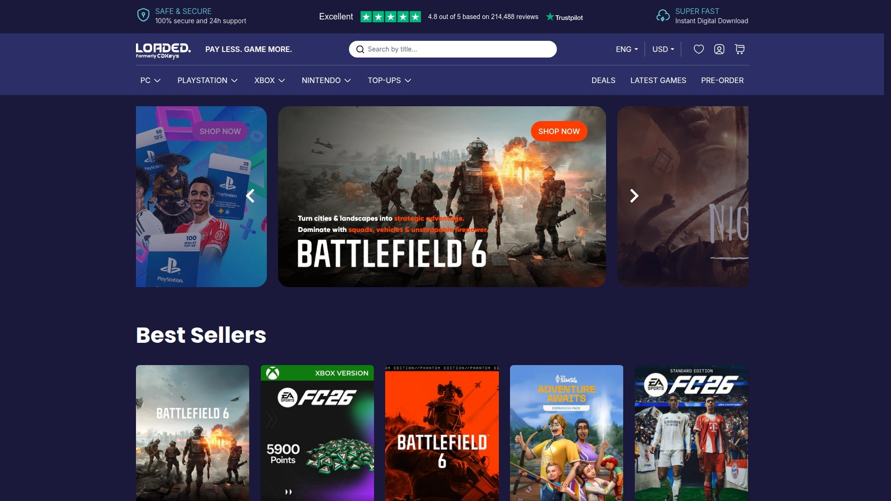

**Official Website:** [cdkeys.com](https://www.loaded.com)

- Specializes in Xbox Game Pass Ultimate, PlayStation Plus subscriptions, and new releases at 30-50% below standard retail without requiring buyer protection upsells
- Processes orders immediately with automated email delivery; rare key issues resolved through ticket system averaging 12-hour response times
- Regional pricing varies by currency but consistently undercuts Steam and console digital storefronts during launch windows
- **Why Choose This:** Unlike marketplace models, CDKeys sources inventory directly through authorized channels and wholesale agreements, eliminating fraudulent key risks while maintaining lower overhead costs. The platform's longevity since 2009 demonstrates sustained publisher relationships despite occasional Reddit controversies regarding gray-market perceptions.

**Ideal For:** Console subscribers seeking discounted membership renewals and preorder savings

**Getting Started:** No account required for checkout; guest purchases complete in under 5 minutes

## **[Kinguin](https://www.kinguin.net)**

Third-party marketplace offering seller competition across 30,000+ titles with flat 5% revenue sharing for buyers and optional buyer protection upgrades adding transaction insurance.

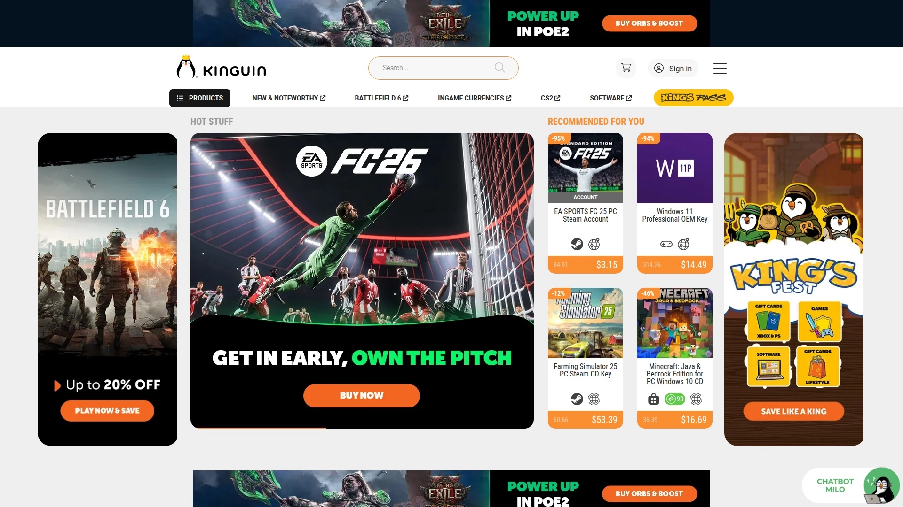

**Official Website:** [kinguin.net](https://www.kinguin.net)

- Permanent cookies track purchases indefinitely, allowing late conversions without expiration timelines common to competing platforms
- Influencer program elevates high-traffic promoters to 10% flat fees after demonstrating 10,000+ social media followers and consistent conversion rates
- Customer-to-customer sales permit occasional key reselling without business registration for users clearing unused bundle codes
- **Why Choose This:** Kinguin's transparent tiered structure separates casual resellers from verified merchants while offering price-matching across competing listings. The buyer protection fee (approximately $1-3 per purchase) provides priority support and guaranteed refunds, addressing the platform's historical fraud concerns through optional insurance.

**Ideal For:** Deal hunters willing to vet individual sellers for lowest-possible pricing

**Getting Started:** Listings display seller ratings prominently; purchases without protection complete in 3 minutes

## **[G2A](https://www.g2a.com)**

Large-scale marketplace pioneering the peer-to-peer game key model with Goldmine partnership program featuring three-tier revenue distribution and credit-based seller rewards.

**Official Website:** [g2a.com](https://www.g2a.com)

- Three-level referral system compounds earnings through downstream sales, though second and third tiers pay reduced percentages
- Paid G2A Shield subscription ($3/month) unlocks expedited support, automatic refunds, and protection against deactivated keys
- Extensive catalog covers indie bundles, AAA preorders, and regional variants often removed from official stores
- **Why Choose This:** Despite controversies regarding key sourcing transparency, G2A's scale provides unmatched inventory breadth and frequent flash sales undercutting authorized retailers by 60-80%. The platform's voluntary seller verification and buyer protection options mitigate historical issues with fraudulent keys sourced from stolen credit cards.

**Ideal For:** Experienced buyers comfortable evaluating seller reputation metrics and accepting gray-market risks

**Getting Started:** Free accounts access all listings; Shield subscription adds protection layer

## **[Humble Bundle](https://www.humblebundle.com)**

Charity-focused storefront bundling indie and AAA titles in pay-what-you-want tiers while directing proceeds to publishers, creators, and verified nonprofit organizations.

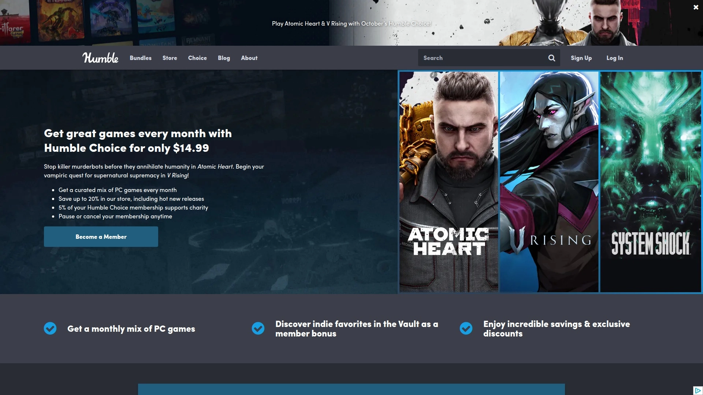

**Official Website:** [humblebundle.com](https://www.humblebundle.com)

- Monthly subscription ($11.99) unlocks curated game collections averaging $200+ retail value with DRM-free downloads and Steam keys included
- Verified Partner program hand-selects high-performing promoters for increased revenue splits without published percentage tiers
- Every purchase allocates funds across three recipients: developers, charity, and platform operations with user-adjustable sliders
- **Why Choose This:** Humble's direct publisher partnerships guarantee legitimate key sources while supporting causes like Save the Children and AbleGamers Foundation. Bundle overpurchases frequently result in tradeable keys appearing on reseller markets, creating secondary value for subscribers.

**Ideal For:** Gamers valuing charity contributions and curated monthly surprises over targeted purchases

**Getting Started:** Free bundles available immediately; Choice subscription starts first Friday of each month

## **[Green Man Gaming](https://www.greenmangaming.com)**

Authorized retailer partnering with 1,350+ publishers to sell platform-agnostic keys across Steam, Uplay, Origin, and Epic with transparent sourcing labels per listing.

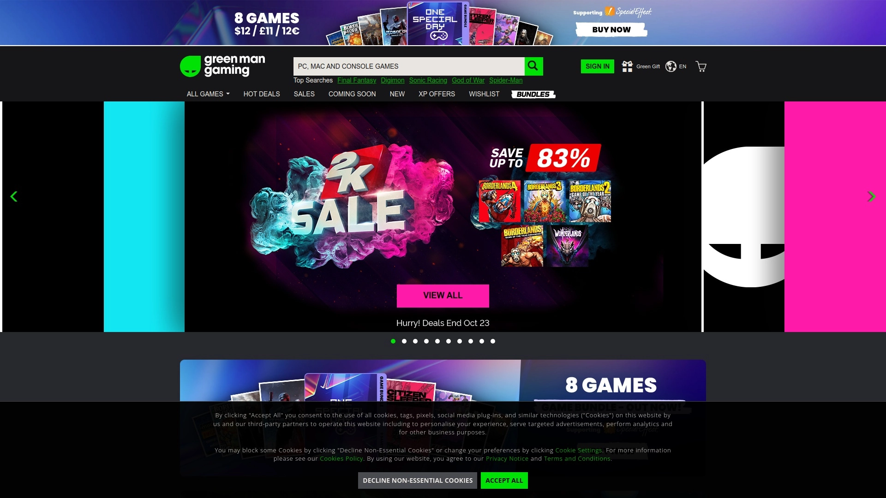

**Official Website:** [greenmangaming.com](https://www.greenmangaming.com)

- Operates in 195 countries with 150+ payment methods and 18 currency options serving 4.7 million registered users
- VIP loyalty program rewards repeat purchases with exclusive discounts, free games, and early access to publisher sales
- Shows key source details (publisher-direct vs. wholesale) and platform DRM requirements before checkout
- **Why Choose This:** Green Man Gaming's authorized status with major publishers like Activision and EA ensures keys never face deactivation risks common to unauthorized gray markets. Frequent publisher-sponsored sales reach 90% off during seasonal events, rivaling unauthorized resellers without fraud exposure.

**Ideal For:** Risk-averse buyers prioritizing authorized channels with legitimate discounts

**Getting Started:** Account creation unlocks VIP tracking; keys deliver instantly for catalog titles

## **[Fanatical](https://www.fanatical.com)**

Bundle specialist offering themed game collections with tiered pricing and individual key sales across 10,000+ Steam, Epic, and Origin titles.

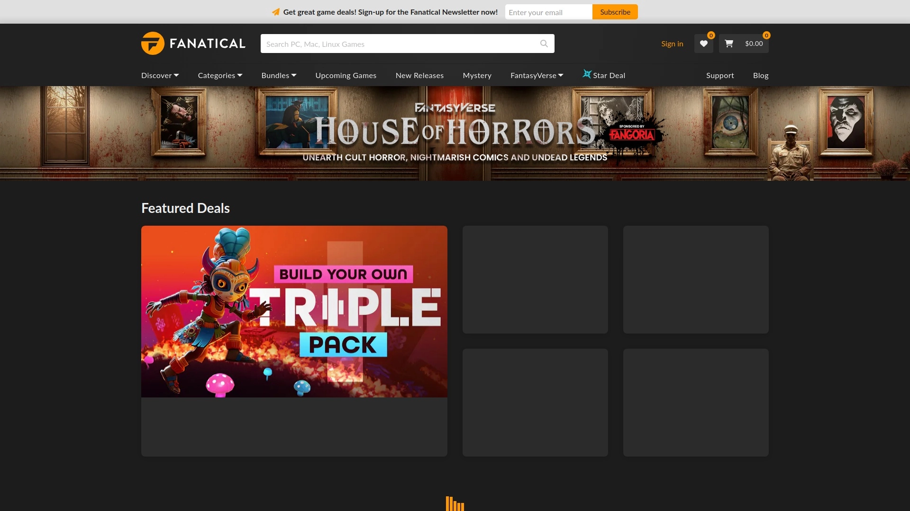

**Official Website:** [fanatical.com](https://www.fanatical.com)

- Partner program splits affiliates into website/blog track (via Commission Junction) and streamer/YouTuber track (direct signup) with 2-5% commissions
- Daily deals rotate discounts up to 95% off indie titles and back-catalog AAA games with build-your-own-bundle options
- Maintains 4.6/5 Trustpilot rating across 766,000+ reviews citing instant delivery and responsive support
- **Why Choose This:** Fanatical's direct partnerships with 1,000+ indie developers provide officially licensed bundles unavailable elsewhere while supporting smaller studios. The platform's bundle flexibility allows mixing genres to reach discount tiers without forcing unwanted titles.

**Ideal For:** Indie game enthusiasts seeking curated bundles and experimental titles

**Getting Started:** No account required for browsing; purchases deliver keys via email in under 5 minutes

## **[GOG (Good Old Games)](https://www.gog.com)**

DRM-free storefront specializing in classic PC games with modern compatibility patches, running publisher-approved AdTraction partnership program with 6% net sales commissions.

**Official Website:** [gog.com](https://www.gog.com)

- All games download installer files enabling offline play without client software or activation requirements
- 30-day refund policy covers all purchases regardless of playtime, exceeding Steam's 2-hour window
- Galaxy client provides optional cross-platform library aggregation while preserving DRM-free downloads
- **Why Choose This:** GOG's exclusive focus on DRM-free distribution appeals to preservation-minded gamers and users with unreliable internet access. The platform's 7-day attribution window tracks cross-device purchases, crediting promoters for mobile completions after desktop browsing sessions.

**Ideal For:** Players prioritizing game ownership and offline access over rental-style licensing

**Getting Started:** Browser-based store requires no software; optional Galaxy client adds social features

## **[Instant Gaming](https://www.instant-gaming.com)**

Dubai-based key retailer operating since 2015 with aggressive discounting across 10,000+ titles and 4.7/5 Trustpilot rating from 766,000+ customer reviews.

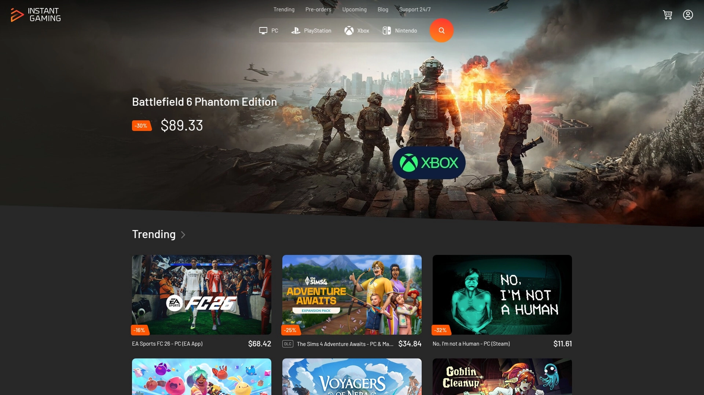

**Official Website:** [instant-gaming.com](https://www.instant-gaming.com)

- Delivers official activation codes (not user-resold keys) instantly via email and web portal with 98% support reply rate within 24 hours
- Supports Steam, Xbox, PlayStation, Uplay, and Origin with region lock warnings displayed before checkout
- Clean interface prioritizes search functionality and wishlisting over promotional clutter
- **Why Choose This:** Instant Gaming's direct sourcing model eliminates marketplace fraud risks while maintaining gray-market pricing through volume agreements. The platform's human support team (not chatbots) resolves issues faster than automated systems common to larger marketplaces.

**Ideal For:** European gamers seeking aggressive discounts with reliable delivery timelines

**Getting Started:** Account creation optional for guest checkout; registered users track order history

## **[GamersGate](https://www.gamersgate.com)**

Swedish digital distributor founded 2006 offering 5% commission partnerships through Awin network with 30-day cookie tracking and quarterly publisher sales.

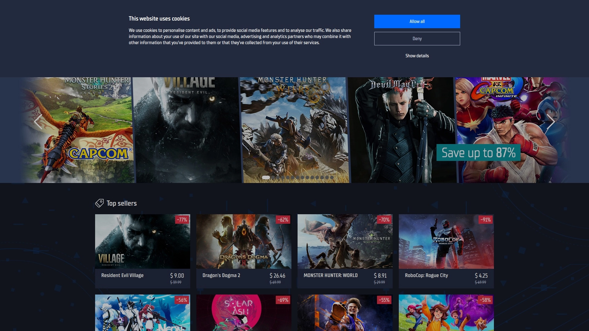

**Official Website:** [gamersgate.com](https://www.gamersgate.com)

- Blue Coins loyalty program rewards purchases with store credit redeemable on future orders at 1 coin per $1 spent
- Operates regional storefronts with localized pricing in Euros, USD, GBP, and SEK
- Exclusive deals with Nordic publishers provide early access to Scandinavian indie titles
- **Why Choose This:** GamersGate's 19-year operation demonstrates sustained publisher relationships and financial stability rare among gray-market competitors. The platform's loyalty rewards compound over time, providing returning customers 5-10% effective discounts through credit accumulation.

**Ideal For:** Long-term platform users valuing loyalty rewards over single-transaction savings

**Getting Started:** Free account enables Blue Coins tracking; keys deliver instantly for most titles

## **[Gamesplanet](https://www.gamesplanet.com)**

Officially licensed retailer operating UK, French, German, and US storefronts with direct publisher partnerships and influencer-friendly revenue sharing plus community discount codes.

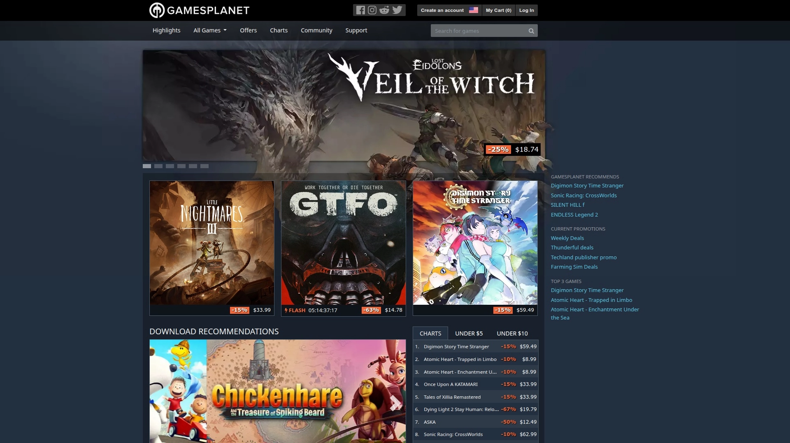

**Official Website:** [gamesplanet.com](https://www.gamesplanet.com)

- Partners receive personalized community discount vouchers under performance conditions, allowing audience-specific promotions
- Key sponsorship program provides free review copies to qualifying content creators with proven reach metrics
- Let's Play videos can be embedded on product pages, creating promotional symbiosis between creators and store
- **Why Choose This:** Gamesplanet's authorized status with Activision, EA, Ubisoft, and Focus Home Interactive guarantees keys never face deactivation. The platform's multi-storefront structure allows price arbitrage across regional sites while maintaining single-account convenience.

**Ideal For:** Content creators seeking revenue diversification beyond YouTube/Twitch monetization

**Getting Started:** Separate accounts required per regional storefront; keys activate globally unless marked

## **[HRK Game](https://www.hrkgame.com)**

Global key marketplace offering 5% partnership commissions with automated delivery systems and multi-platform support across Steam, Origin, Uplay, and console networks.

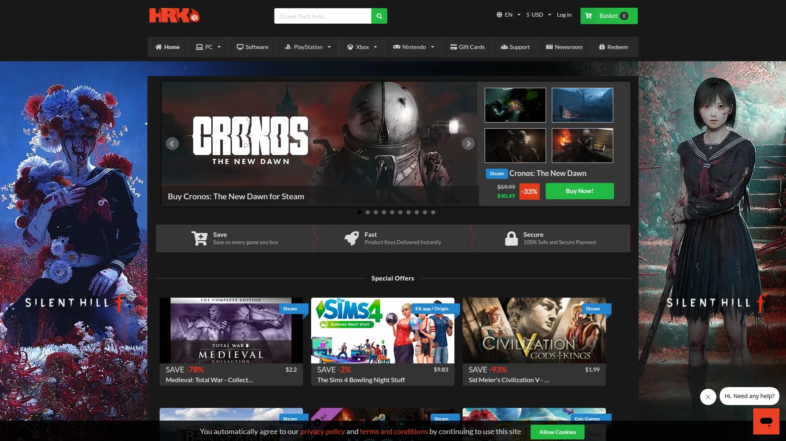

**Official Website:** [hrkgame.com](https://www.hrkgame.com)

- Referral links track indefinitely without expiration, crediting promoters for delayed conversions
- Supports cryptocurrency payments including Bitcoin and Ethereum alongside traditional methods
- Frequent flash sales rotate every 8 hours with discounts reaching 85% off catalog titles
- **Why Choose This:** HRK's cryptocurrency payment integration appeals to privacy-conscious buyers and international customers avoiding currency conversion fees. The platform's lifetime referral tracking provides passive income potential from shared links across evergreen content.

**Ideal For:** Crypto-native gamers and content creators with persistent promotional channels

**Getting Started:** Account optional for guest purchases; registered users access order history tracking

## **[AllKeyShop](https://www.allkeyshop.com)**

Price comparison aggregator partnering with 30+ verified sellers while operating streamer and website partnership programs with coin-based reward systems.

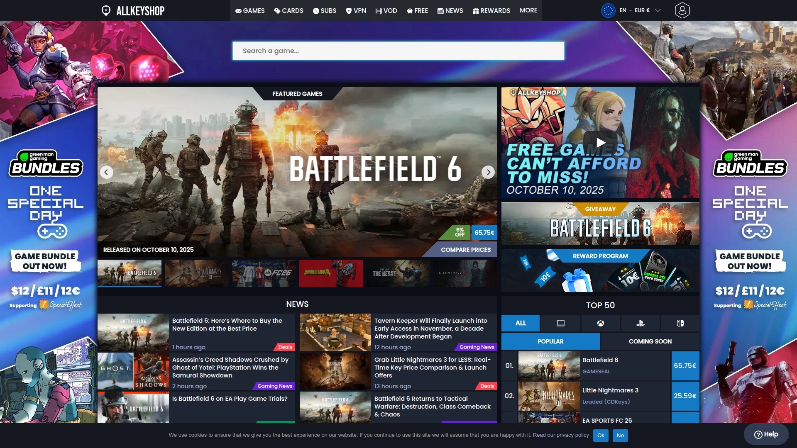

**Official Website:** [allkeyshop.com](https://www.allkeyshop.com)

- Giveaway wheel system rewards streamers 0.30 coins per new user registration and 0.10 coins per returning participant
- Partner banner clicks generate 0.05 coins daily per unique visitor, compounding promotional value
- Browser extension overlays price comparisons on Steam, Origin, and Uplay product pages automatically
- **Why Choose This:** AllKeyShop's aggregation model eliminates single-vendor lock-in while verifying seller legitimacy through partnership vetting. The coin economy allows streamers to self-fund giveaways through audience engagement rather than upfront capital.

**Ideal For:** Streamers building communities through regular giveaways and deal curation

**Getting Started:** Minimum 1 giveaway wheel monthly required; starter pack includes 5 coins

## **[IndieGala](https://www.indiegala.com)**

Italian bundle storefront founded 2011 specializing in pay-what-you-want indie collections with charity components supporting Save the Children and regional disaster relief.

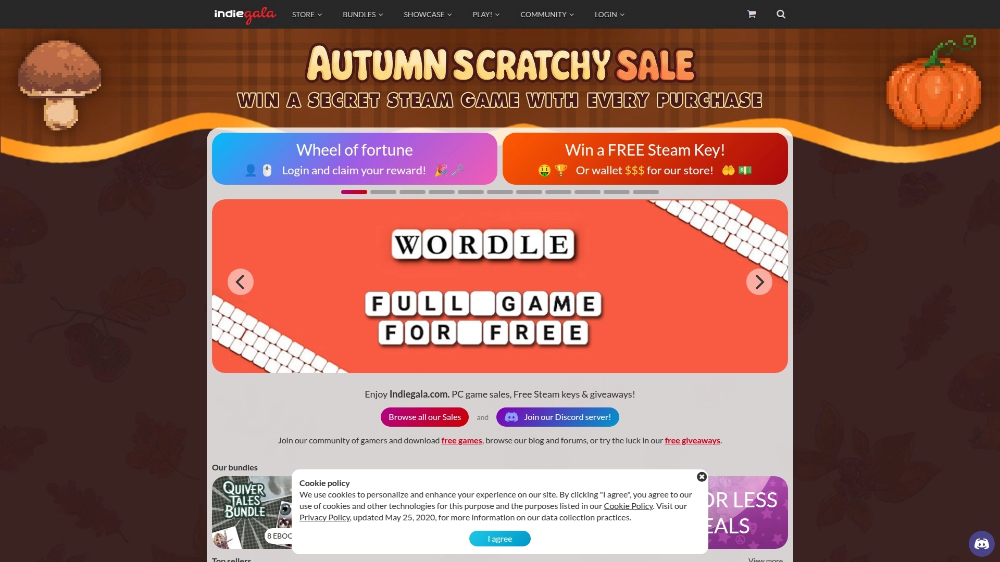

**Official Website:** [indiegala.com](https://www.indiegala.com)

- Expanded from bundles to include persistent storefront, Steam-like client, publishing arm, and indie developer fund
- Offers DRM-free games, Android titles, graphic design assets, digital comics, and music albums alongside standard game keys
- Headquartered in Rome with 25 employees supporting EU-focused operations and customer service
- **Why Choose This:** IndieGala's Italian Red Cross partnership during the 2012 Emilia Romagna earthquake established credibility for charitable gaming purchases. The platform's diversification into publishing and development creates exclusive content unavailable through pure resellers.

**Ideal For:** Indie enthusiasts supporting smaller developers and charitable causes simultaneously

**Getting Started:** Free account required for bundle participation; keys reveal immediately after payment

## **[Gamivo](https://www.gamivo.com)**

Emerging marketplace combining user-to-user sales with verified merchant listings, requiring optional Smart protection purchases for priority support and refund guarantees.

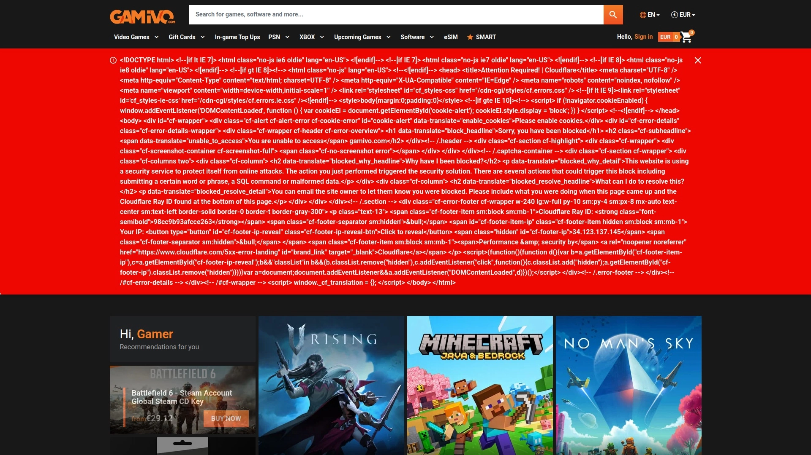

**Official Website:** [gamivo.com](https://www.gamivo.com)

- Smart subscription ($1-2 per transaction) mirrors Kinguin's buyer protection model with expedited dispute resolution
- Supports over 15,000 titles across PC, Xbox, PlayStation, and Nintendo platforms with instant delivery
- Price-matching algorithm continuously updates listings based on competitor pricing scraped hourly
- **Why Choose This:** Gamivo's competitive pricing frequently undercuts G2A and Kinguin by 5-15% due to lower platform fees. The marketplace's European base provides stronger consumer protection enforcement compared to offshore competitors.

**Ideal For:** Price-sensitive buyers willing to compare seller ratings for maximum savings

**Getting Started:** Account creation takes 90 seconds; Smart protection optional at checkout

## **[MMOGA](https://www.mmoga.com)**

German-based virtual goods marketplace operating since 2007 specializing in MMO currency, game keys, and console network cards with 90% discount events on EA titles.

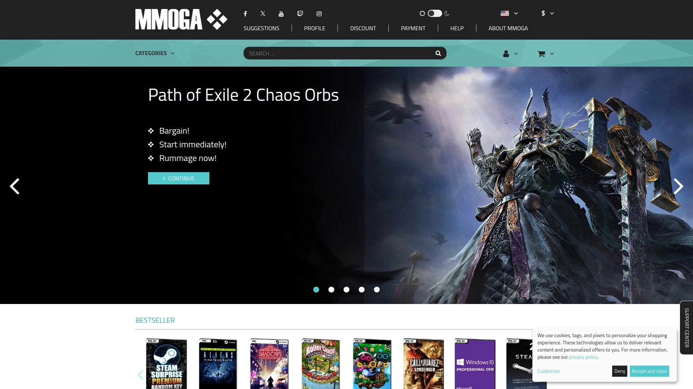

**Official Website:** [mmoga.com](https://www.mmoga.com)

- Supports 25+ payment methods including regional options like Giropay, iDEAL, and Carte Bleue unavailable on US-focused platforms
- Mobile apps for iOS and Android enable purchases with biometric authentication and push sale notifications
- Minimum age requirement of 13 years (18 in restricted regions) with parental consent verification for minors
- **Why Choose This:** MMOGA's specialization in MMO virtual currency provides one-stop shopping for World of Warcraft gold, Final Fantasy XIV gil, and other in-game economies alongside standard game keys. The platform's German headquarters subject transactions to EU consumer protection laws stronger than gray-market alternatives.

**Ideal For:** MMO players seeking consolidated virtual goods and game key purchasing

**Getting Started:** Account required for order tracking; delivery within 30 minutes for automated keys

## **[DLGamer](https://www.dlgamer.com)**

French digital retailer authorized by publishers since 2004 with IsThereAnyDeal listing and consistent Trustpilot ratings above 4 stars across regional operations.

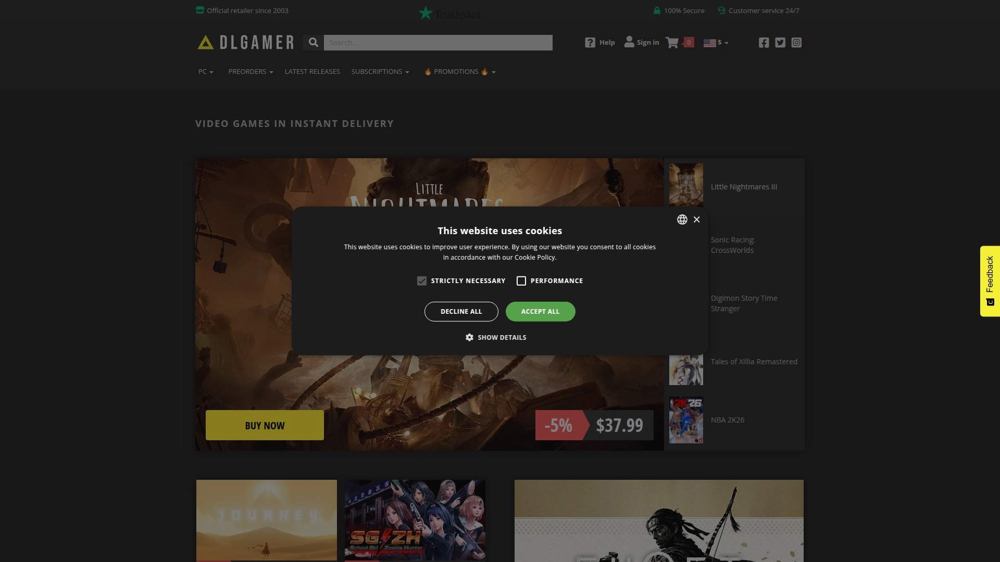

**Official Website:** [dlgamer.com](https://www.dlgamer.com)

- Operates separate storefronts for US, UK, France, Germany, and Spain with localized pricing and VAT handling
- Official partnerships with Ubisoft, Square Enix, and Bethesda provide day-one releases at competitive pricing
- Accepts PayPal, credit cards, and regional payment methods with instant automated delivery for most catalog titles
- **Why Choose This:** DLGamer's IsThereAnyDeal verification confirms authorized retailer status, ensuring keys never face publisher deactivation. The platform's longevity since 2004 demonstrates sustained legitimacy despite lacking Steam's official reseller designation.

**Ideal For:** EU gamers prioritizing authorized channels with regional payment convenience

**Getting Started:** Language auto-detects based on IP; manual storefront switching available

## **[WinGameStore](https://www.wingamestore.com)**

Decade-old PC game retailer offering 5% partnership commissions through direct signup with 7-day return windows and no advertisements cluttering storefront.

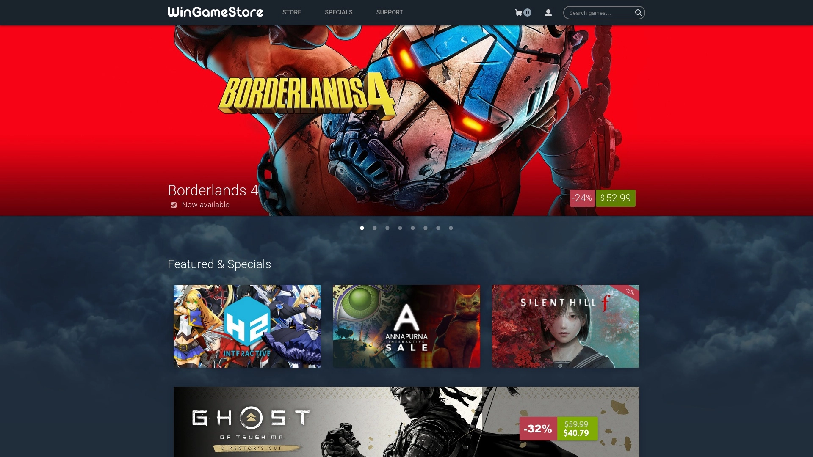

**Official Website:** [wingamestore.com](https://www.wingamestore.com)

- Sister site MacGameStore provides dedicated macOS game selection with compatibility testing and launcher support
- Partnership terms include 7-day cookie attribution and monthly payout schedules via PayPal
- Clean interface prioritizes search and wishlisting over promotional banners common to larger marketplaces
- **Why Choose This:** WinGameStore's ad-free experience and bot-free customer service create frictionless shopping emphasized by decade-long operation. The platform's 5% commission rate matches or exceeds competing programs while maintaining simpler terms than tiered structures.

**Ideal For:** Windows and Linux gamers seeking distraction-free shopping with responsive human support

**Getting Started:** No account required for guest checkout; registered users save payment methods

## **[Voidu](https://www.voidu.com)**

Modern key retailer emphasizing sleek UI/UX design with frequent discount codes reaching 20-30% off already-reduced catalog pricing.

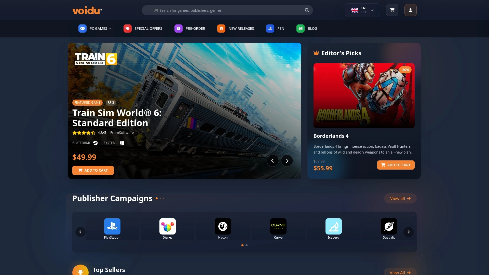

**Official Website:** [voidu.com](https://www.voidu.com)

- Coupon codes stack with sale pricing for compound discounts rarely available on competing platforms
- Supports Steam, Epic Games Store, Uplay, Origin, and Battle.net activation across 8,000+ titles
- Email subscription provides exclusive discount codes sent weekly with new release highlights
- **Why Choose This:** Voidu's stackable discount model enables savvy shoppers to achieve prices 10-20% below IsThereAnyDeal aggregator lows. The platform's focus on UX polish creates smoother checkout flows than legacy competitors with dated interfaces.

**Ideal For:** Deal-focused buyers monitoring coupon databases and discount tracking communities

**Getting Started:** Guest checkout available; registered accounts access order history and wishlists

## **[Chrono.gg](https://www.chrono.gg)**

Daily deal curator featuring single game promotions for 24-hour windows with verified direct-from-developer Steam key sourcing.

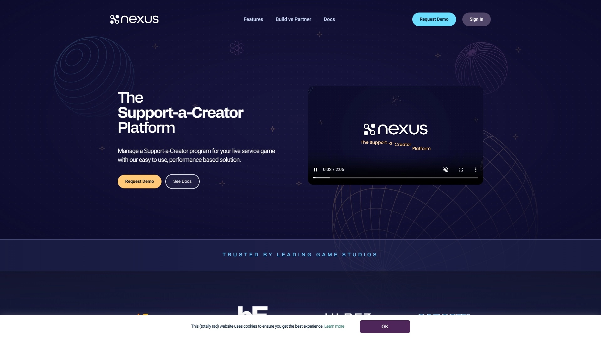

**Official Website:** [chrono.gg](https://www.chrono.gg)

- Partnership model pays percentage of revenue to promoters featuring daily deals through social media
- Focuses on indie titles and back-catalog games from developers like Banner Saga and Warhammer teams
- Transparent sourcing confirmed by both platform and individual developers as 100% legitimate Steam keys
- **Why Choose This:** Chrono.gg's single-game focus creates curated discovery absent from overwhelming storefronts with 10,000+ simultaneous listings. The platform's developer-direct model ensures proceeds benefit creators rather than gray-market intermediaries.

**Ideal For:** Indie supporters preferring curated daily recommendations over exhaustive catalog browsing

**Getting Started:** No account required; 24-hour timer resets daily at consistent time

## **[GameBillet](https://www.gamebillet.com)**

Authorized UK retailer featured on IsThereAnyDeal with direct publisher partnerships and frequent appearance in lowest-price aggregator results.

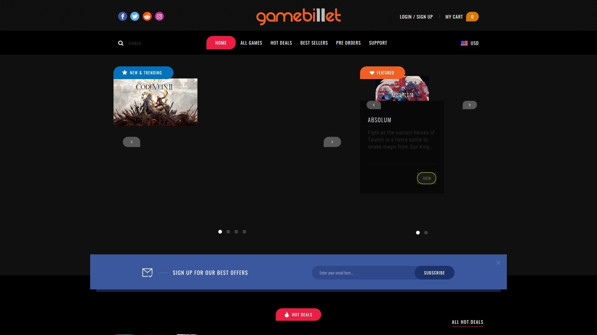

**Official Website:** [gamebillet.com](https://www.gamebillet.com)

- Specializes in pre-order bonuses and day-one discounts through publisher relationships
- Supports Steam, Epic Games Store, Uplay, and Origin with instant automated delivery
- Regional pricing varies between UK and US storefronts with manual selection available
- **Why Choose This:** GameBillet's consistent appearance in IsThereAnyDeal lowest-price alerts demonstrates competitive pricing matching or beating unauthorized resellers. The platform's authorized status eliminates key deactivation risks common to gray markets.

**Ideal For:** Pre-order enthusiasts seeking day-one savings with authorized retailer safety

**Getting Started:** Account optional; keys deliver instantly via email for automated titles

## **[2Game](https://www.2game.com)**

European digital storefront focusing on competitive AAA pricing with instant delivery and multi-platform support across PC gaming ecosystems.

**Official Website:** [2game.com](https://www.2game.com)

- Frequent publisher sales coincide with Steam seasonal events for price parity with additional discounts
- Accepts PayPal, credit cards, and cryptocurrencies with instant email delivery for automated keys
- Wishlisting system sends price drop alerts when tracked titles reach user-defined thresholds
- **Why Choose This:** 2Game's focus on AAA titles from major publishers provides depth in blockbuster categories often underserved by indie-focused bundle sites. The platform's price alert system automates deal hunting for patient gamers willing to wait for target prices.

**Ideal For:** AAA enthusiasts targeting specific titles with flexible purchase timelines

**Getting Started:** Free account enables wishlisting; guest checkout available without registration

## **[GreenManGaming VIP](https://www.greenmangaming.com)**

Premium tier of Green Man Gaming offering exclusive discounts, free games, and early sale access for loyalty program members.

**Official Website:** [greenmangaming.com/vip](https://www.greenmangaming.com)

- Automatic enrollment tracks spending tiers (Silver/Gold/Diamond) unlocking progressive benefits
- Birthday month provides exclusive 15-20% discount codes valid across full catalog
- Early access to publisher sales begins 24-48 hours before public launch
- **Why Choose This:** VIP loyalty compounding provides 10-15% better pricing than competing authorized retailers over multi-year customer lifetimes. The birthday discount timing allows strategic purchasing of wishlisted titles at optimal prices.

**Ideal For:** Frequent buyers consolidating purchases for loyalty tier progression

**Getting Started:** Automatic enrollment begins with first purchase; tier benefits scale with spending

## **[Fanatical Star Deals](https://www.fanatical.com)**

Time-limited flash sale section within Fanatical storefront rotating 24-hour deep discounts on handpicked titles.

**Official Website:** [fanatical.com/star-deals](https://www.fanatical.com)

- Daily rotation features 5-10 titles at 70-95% off with countdown timers creating urgency
- Build-your-own-bundle options let shoppers mix Star Deal titles reaching discount tiers
- Email alerts notify subscribers when wishlisted games enter Star Deal rotation
- **Why Choose This:** Star Deals provide discovery mechanisms surfacing quality indie titles overlooked in crowded storefronts. The rotation strategy creates checkpoint shopping habits driving repeat engagement without overwhelming choice paralysis.

**Ideal For:** Deal hunters checking daily for impulse-friendly discounts on curated selections

**Getting Started:** No account required for browsing; purchases complete in under 3 minutes

## **[Humble Choice](https://www.humblebundle.com/membership)**

Monthly subscription delivering 8-12 curated games for $11.99 with instant access and Steam key generation plus 20% store discount.

**Official Website:** [humblebundle.com/membership](https://www.humblebundle.com/membership)

- Subscribers pause or cancel anytime without penalty, avoiding forced consecutive months
- All games remain in library permanently even after subscription cancellation
- Store discount stacks with sales for compound savings averaging 30-40% off retail
- **Why Choose This:** Choice's monthly model provides $150-250 retail value for $12, averaging 90-95% savings compared to individual purchases. The pause flexibility eliminates pressure to maintain continuous subscriptions during months with unappealing lineups.

**Ideal For:** Gamers open to curated surprises valuing quantity and discovery over targeted purchases

**Getting Started:** First month's games revealed before payment; pause option available monthly

## **[G2Play](https://www.g2play.net)**

Secondary marketplace similar to G2A with independent operation and competitive commission structures targeting Eastern European and CIS markets.

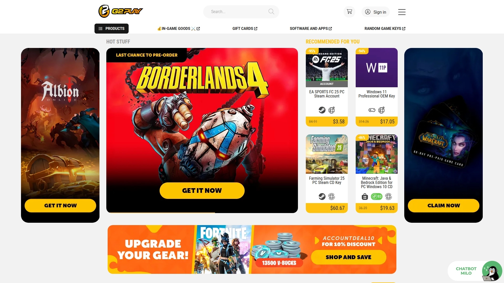

**Official Website:** [g2play.net](https://www.g2play.net)

- Regional focus provides better pricing on titles from Russian and Polish developers
- Buyer protection optional at checkout with similar insurance model to competitors
- Supports cryptocurrency payments and regional methods like Qiwi and WebMoney
- **Why Choose This:** G2Play's Eastern European focus provides geographic diversification for buyers seeking region-specific titles and pricing structures. The platform's cryptocurrency support appeals to privacy-conscious international shoppers.

**Ideal For:** CIS region gamers and cryptocurrency users seeking localized payment options

**Getting Started:** Account creation requires email verification; guest checkout unavailable

## Comparison Table

| Platform | Primary Model | Buyer Protection | Commission Rate | Cookie Duration |
|----------|---------------|------------------|-----------------|-----------------|
| Eneba | Marketplace | Included | Not disclosed | Varies |
| CDKeys | Direct Retailer | Included | 5% | Not disclosed |
| Kinguin | Marketplace | Optional ($1-3) | 5% (10% influencer) | Permanent |
| G2A | Marketplace | Paid subscription | Variable tiers | Not disclosed |
| Humble Bundle | Bundle + Store | Included | Not disclosed | Not disclosed |
| Green Man Gaming | Authorized Retailer | Included | 1-3% | Not disclosed |
| Fanatical | Bundle + Store | Included | 2-5% | 30 days |
| GOG | DRM-Free Store | Included (30-day refund) | 6% | 7 days |

### Selection Guide

Budget-focused shoppers comparing multiple sellers should prioritize Eneba, Gamivo, or AllKeyShop for marketplace competition driving lowest prices, while accepting slightly elevated fraud risks mitigated through buyer protection options. Authorized channel preference dictates Green Man Gaming, Gamesplanet, or GameBillet for publisher-direct sourcing eliminating deactivation concerns despite 10-20% higher pricing than gray markets. Subscription-based discovery suits Humble Choice or Fanatical Star Deals for curated monthly value averaging 90% savings versus individual purchases. Content creators monetizing audiences benefit from Kinguin's permanent cookie tracking or Gamesplanet's community discount codes creating passive income from shared promotional links.

### FAQ

**Does Eneba support instant delivery for all platforms?**

Eneba delivers Steam, Epic Games Store, Origin, Uplay, Xbox, PlayStation, and Nintendo keys instantly via email and web portal for automated inventory, with manual seller fulfillment typically completing within 2 hours for marketplace listings. Region locks display prominently before checkout, with VPN usage prohibited per terms of service to prevent activation fraud.

**How do marketplace buyer protection fees work?**

Platforms like Kinguin and Gamivo charge optional $1-3 protection fees per transaction unlocking priority support queues, guaranteed refunds for non-working keys, and automated replacement processes bypassing manual ticket submission. Free purchases rely on seller ratings and platform dispute systems averaging 48-72 hour resolution times compared to 12-24 hours with protection.

**Can I resell unused bundle keys legally?**

Humble Bundle terms prohibit commercial key reselling but allow personal gifting, while marketplaces like Kinguin explicitly permit customer-to-customer sales for small quantities without business registration requirements. Publisher EULAs technically restrict most key transfers, though enforcement remains inconsistent across platforms.

### Conclusion

These 25 verified marketplaces provide spectrum coverage from budget-prioritizing gray markets to authorized retailers balancing safety and value. [Eneba](https://www.eneba.com) excels for shoppers seeking aggressive discounts up to 70% off retail while maintaining buyer protection policies and instant delivery across PC and console platforms. Compare seller ratings carefully when using marketplace models, and prioritize authorized channels like Green Man Gaming or Fanatical when publisher relationships matter more than marginal savings. **Start comparing prices across platforms now to maximize savings on your next gaming purchase.**
